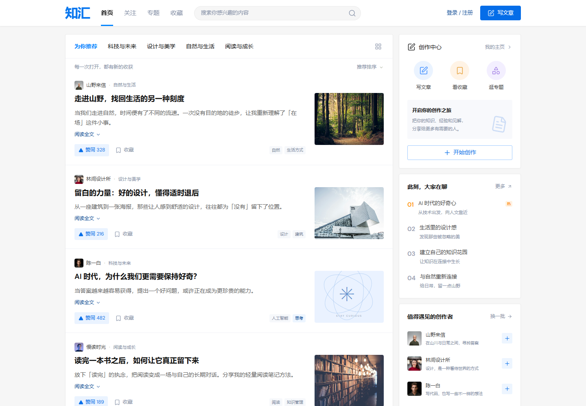
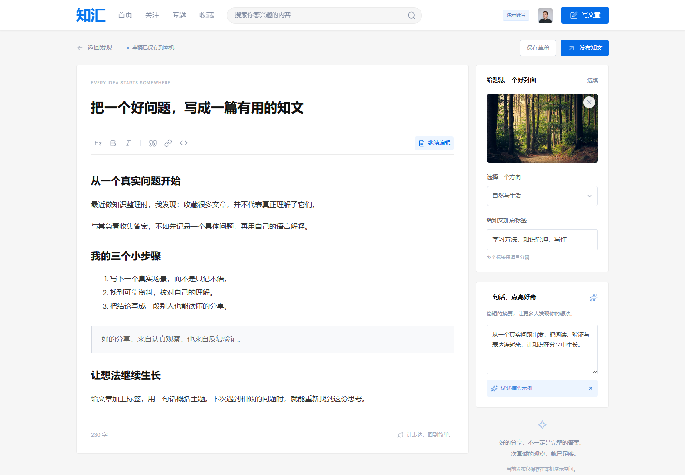
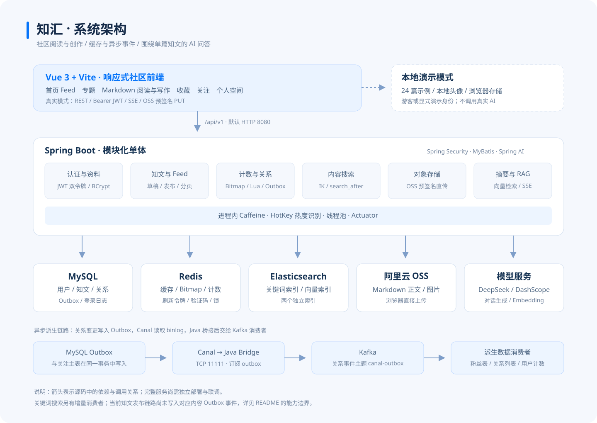

# 知汇 · 智能知识分享平台

一个支持文章发布、社区互动、全文搜索和 AI 知识问答的项目。前端采用蓝白社区风格，后端围绕缓存、异步事件和 RAG 组织核心业务。



## 核心亮点

- **双 Token 认证**：Spring Security + RS256 JWT，Redis 管理刷新令牌，支持验证码、密码登录和令牌轮换。
- **缓存与热点优化**：Caffeine + Redis 缓存，结合 SingleFlight、热 Key 识别、动态 TTL 与随机过期抖动，减少重复回源。
- **互动与异步计数**：Redis 分片 Bitmap + Lua 完成点赞、收藏判重，通过 Kafka 聚合增量，减少逐次更新开销。
- **事件驱动的关注关系**：following + Outbox 写入、Canal 订阅 binlog、Kafka 消费，更新粉丝表、列表缓存与用户计数。
- **AI 与搜索**：Spring AI + DeepSeek 生成摘要和 RAG 问答；Elasticsearch 提供全文检索、向量检索与搜索游标分页，SSE 流式输出回答。
- **对象存储直传**：Markdown 正文、封面通过 OSS 预签名上传，按草稿、正文确认、元数据更新、发布分步完成。

## 技术栈

| 层次 | 技术 |
| --- | --- |
| 前端 | Vue 3、Vite、Lucide、Marked、DOMPurify、自定义 CSS |
| 后端 | Java 21、Spring Boot 3.2.4、Spring Security、MyBatis、Spring AI 1.0.3 |
| 数据与缓存 | MySQL、Redis、Caffeine、Redisson |
| 消息与检索 | Kafka、Canal、Elasticsearch、IK 中文分词 |
| 存储与模型 | 阿里云 OSS、DeepSeek、DashScope Embedding |

## 核心功能

| 模块 | 功能 |
| --- | --- |
| 内容浏览 | 首页 Feed、专题分类、文章详情、搜索、每批 12 篇的“加载更多”分页 |
| 创作发布 | Markdown 编辑与预览、封面、标签、摘要、草稿保存和发布 |
| 社区互动 | 点赞、收藏、关注、个人主页与资料编辑 |
| 用户认证 | 手机号／邮箱注册、密码／验证码登录、刷新令牌和退出 |
| AI 助手 | 写作页生成摘要；文章页围绕正文提问，支持流式回答和停止 |

前端提供 **24 篇完整示例、4 个分类和本地头像**。首次进入可选择游客浏览，或手动使用演示账号；预设资料不会自动产生登录态。

<details>
<summary>查看文章、写作页面与系统架构</summary>






</details>

## 快速启动前端

需要 **Node.js ≥ 22.12.0**。在项目根目录执行：

```powershell
Set-Location .\frontend
npm.cmd ci --cache ..\.npm-cache
npm.cmd run dev
```

也可双击 [frontend/启动前端.cmd](frontend/启动前端.cmd)。打开 **[http://127.0.0.1:5173/](http://127.0.0.1:5173/)**，在运行终端按 `Ctrl+C` 停止。

- **演示模式**：无需后端，数据保存在当前浏览器；AI 是明确标注的本地示例。
- **真实模式**：在页面“连接设置”中选择“连接真实后端”，再注册／登录。需要后端及相关服务可用。

## 关键配置

### 前端代理

复制 [frontend/.env.example](frontend/.env.example) 为 `frontend/.env.local`：

```dotenv
API_PROXY_TARGET=http://127.0.0.1:8080
```

修改后重启 Vite。生产环境通过反向代理转发 `/api/`，参考 [Nginx 示例](docs/config/nginx.conf.example)。

### 后端配置

默认配置位于 [application.yml](src/main/resources/application.yml)，本机覆盖配置使用 [application-local.example.yml](docs/config/application-local.example.yml)。

| 项目 | 配置要点 |
| --- | --- |
| 数据库 | 默认库 `zhiguang`、端口 `3306`；本地模板使用 `DB_URL`、`DB_USERNAME`、`DB_PASSWORD` |
| Redis | 默认 `6379`；设置 `REDIS_HOST`、`REDIS_PORT`、`REDIS_PASSWORD`，与实际实例一致 |
| Kafka | 默认 `9092`；准备 `counter-events`、`canal-outbox` 两个主题 |
| Elasticsearch | 默认 `9200`；安装匹配的 IK 插件；Embedding 与向量索引维度保持 `1536` 一致 |
| Canal | TCP 端口 `11111`，订阅 `zhiguang.outbox`；MySQL 需开启 ROW binlog |
| DeepSeek | 设置 `DP_API_KEY`，用于摘要与问答 |
| DashScope | 设置 `API_KEY`，用于 `text-embedding-v4` 向量生成 |
| OSS | 设置 `OSS_BUCKET`、`OSS_ACCESS_KEY_ID`、`OSS_ACCESS_KEY_SECRET`；按地域调整 Endpoint |
| JWT | 本地模板读取 `config/keys/private.pem` 与 `public.pem` |

环境变量应配置在 **启动 Java 的终端或 IDEA 运行配置中**，后端不会自动读取前端 `.env.local`。模型 Key 和 OSS Secret 不应放入 `VITE_` 变量。

仓库不包含 JWT 私钥或真实服务凭证。按下面的步骤生成本机密钥；JWT 单元测试在运行时临时生成 RSA 密钥，不依赖本地文件。

OSS 需允许前端来源的 `PUT / GET / HEAD`，暴露 **ETag** 响应头，并确保正文和封面 URL 可读。只配置跨域不等于授予私有对象读取权限。

其他模板：[MySQL binlog](docs/config/mysql-binlog.cnf.example)、[Canal instance](docs/config/canal-instance.properties.example)。数据库、索引和本地存储的历史标识沿用原值，兼容已有数据。

## 启动真实后端

先准备 **JDK 21、Maven、MySQL、Redis、Kafka、Elasticsearch + IK、Canal、OSS 和模型凭证**，然后在项目根目录完成以下步骤。

**1. 初始化数据库。** 进入 MySQL 客户端后执行：

```sql
CREATE DATABASE IF NOT EXISTS zhiguang CHARACTER SET utf8mb4;
USE zhiguang;
SOURCE db/schema.sql;
```

**2. 创建本机配置。** 填入上一节的实际连接信息和环境变量：

```powershell
New-Item -ItemType Directory -Force .\config | Out-Null
if (-not (Test-Path -LiteralPath '.\config\application-local.yml')) {
    Copy-Item .\docs\config\application-local.example.yml .\config\application-local.yml
}
```

**3. 准备 JWT 密钥。** 安装 OpenSSL 后生成；已有自己的密钥可直接配置相应路径：

```powershell
New-Item -ItemType Directory -Force .\config\keys | Out-Null
openssl genpkey -algorithm RSA -pkeyopt rsa_keygen_bits:2048 -out .\config\keys\private.pem
openssl pkey -in .\config\keys\private.pem -pubout -out .\config\keys\public.pem
```

**4. 编译并启动。** 确认 Maven 使用 JDK 21：

```powershell
java --version
mvn --version
mvn -DskipTests package
mvn spring-boot:run '-Dspring-boot.run.profiles=local'
```

**5. 检查接口并连接前端。**

```powershell
Invoke-RestMethod 'http://127.0.0.1:8080/actuator/health'
Invoke-RestMethod 'http://127.0.0.1:8080/api/v1/knowposts/feed?page=1&size=12'
```

**8080 是后端 HTTP 端口，11111 是 Canal 端口。** 新数据库没有前端示例文章，切换真实模式后需要自行注册和发布。

## 使用与验证说明

- Feed 当前按发布时间查询，尚未实现个性化推荐；热 Key 主要用于缓存优化。
- 验证码目前打印到后端日志，未接短信或邮件网关。真实注册联调时从自己的开发日志取码。
- 真实收藏页仅展示本机记录；专用关注文章流、多草稿管理等能力仍需补齐。
- 当前 Boot 3.2.4 与 Spring AI 1.0.3 的兼容性、内容搜索增量链路、Canal 关闭开关和 RAG 权限清理仍需完善。前端演示已验证，真实后端全链路尚未完成联调。

前端检查：

```powershell
Set-Location .\frontend
npm.cmd test
npm.cmd run build
```

现有 **12 项前端测试和生产构建通过**。后端测试命令为 `mvn test`。

更多资料：[前端说明](frontend/README.md) · [知文 API](docs/API接口文档_knowpost.md) · [计数设计](docs/计数系统设计方案.md) · [关系设计](docs/用户关系设计方案.md)。
